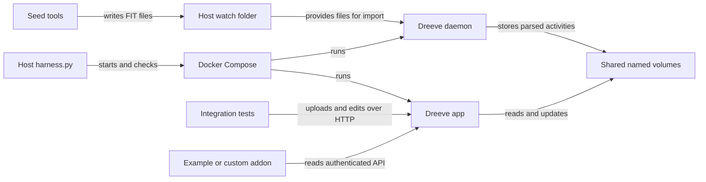

# Architecture

## Overview

The host controller coordinates Compose. Dreeve owns parsing and storage; Python tooling creates fixtures, calls the real API, and checks results. The following diagram shows the two import paths and the addon read path.



## Components

### Controller

`harness.py` uses Python's standard library and fixes paths relative to its own location. It initializes local settings, validates Compose, starts services, builds tools, seeds, and starts the addon. `test` also compares reseeds, restarts services, verifies persistence, and temporarily substitutes a standalone addon. Logs are collected in a `finally` block for test workflows.

### Dreeve application and daemon

`app` and `daemon` use the same digest-pinned Dreeve image, environment, and volumes. The app serves port 8080; the host sees it on loopback port 8103. The daemon runs `bin/console app:daemon:run`. Its upstream five-minute schedule is retained.

`scripts/health.php` checks authenticated API readiness for the app. For the daemon it checks that the SQLite file exists and PID 1's command contains `app:daemon:run`; it does not check cron execution progress. The app health gate precedes daemon and seed startup.

### Tools and addon

`Dockerfile.tools` uses Python 3.12 slim and installs `fit-tool==0.9.16`. The `seed` and `test` one-shot services mount scripts and test source read-only. They share `runtime/`, `watch/`, and `reports/` with the host.

The default addon runs `scripts/addon.py`, serving a read-only JSON snapshot. The standalone `addons/api-inspector` copies its own client into its image and returns a distinct implementation marker. Its successful replacement proves that the controller can run an addon built outside the tools source layout.

## Data flow

1. `init` creates `.env` once, generates secrets and a bcrypt hash, and creates generated directories.
2. `up` validates Compose and waits for app and daemon health.
3. The seed tool chooses a frozen date, writes the fixture manifest and credential handoff, and queues deterministic FIT filenames for missing workout names.
4. The controller invokes Dreeve's explicit file importer, then verifies fixture values through the API.
5. The addon reads paginated activities using the API key and combines them with the manifest.
6. Full tests exercise scheduled watch-folder intake and HTTP uploads, then edit and delete the temporary activities.

Use `python harness.py up` to run the startup flow or `python harness.py test` to include the audit and round-trip flow.

## Storage boundaries

| Location | Owner and purpose | Retained by `down` |
| --- | --- | --- |
| `database` volume | Dreeve SQLite storage at `/var/www/storage/database` | Yes |
| `files` volume | Imported files at `/var/www/storage/files` | Yes |
| `build` volume | Render cache at `/var/www/build` | Yes |
| `watch/` | Files waiting for import | Yes |
| `runtime/` | Frozen fixture manifest, credential handoff, audit state | Yes |
| `reports/` | JUnit, API snapshots, and logs | Yes |
| `.env` | Sandbox credentials and local configuration | Yes, including after reset |

The harness does not define a separate database schema: application schema and migrations belong to the pinned Dreeve image. Tests validate API fields rather than issuing SQL.

## Directory layout

```text
compose.yaml                 App, daemon, tools, addon, and named volumes
compose.addon.example.yaml   Standalone addon replacement
harness.py                   Host lifecycle controller
harness.json                 Platform service and directory settings
upstream.json                Version, image digest, and provenance
scripts/                     API client, fixtures, seed, health, audits, reporting
addons/api-inspector/        Standalone addon build context
tests/unit/                  Host-only controller/client/reporting checks
tests/integration/           Real application contract and platform checks
docs/                        Documentation source
.github/workflows/           Integration and shared documentation callers
```

Read [configuration](./configuration.md) for override precedence and [addon development](./addons.md) for custom services and mounts.
